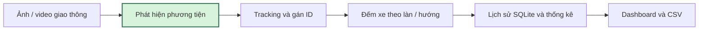
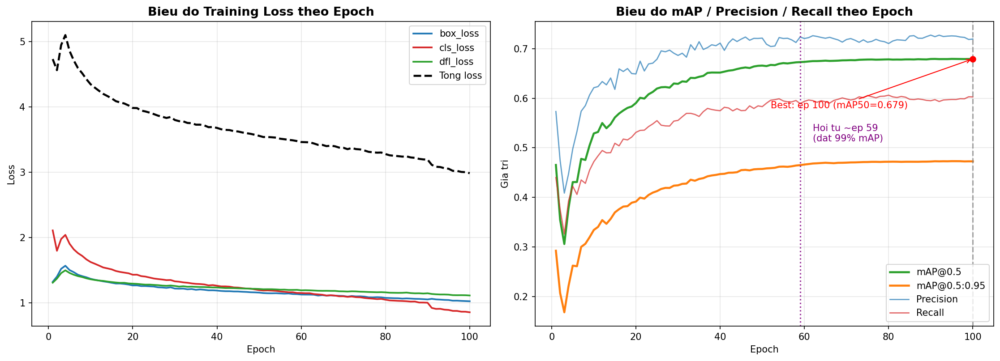

# Traffic Flow Analysis — Detection, Tracking & Dashboard

Đồ án xây dựng nền tảng phân tích lưu lượng giao thông từ ảnh/video. Hệ thống gồm phát hiện bốn lớp `bus`, `car`, `motorcycle`, `truck`, tracking ByteTrack, đếm xe qua vạch theo hướng, lưu SQLite và dashboard Flask. Dashboard chuẩn hóa `motorcycle` thành `motorbike` khi thống kê.

> Cập nhật 28/10/2026: đã đồng bộ mã dashboard và notebook fine-tune/tracking/SQLite từ Drive. Dashboard đã chạy local với checkpoint thật trên video mẫu 149 frame. Kết quả baseline dưới đây là số liệu lịch sử; kiểm tra local không đánh giá lại mAP hay huấn luyện lại mô hình. Xem [kết quả validation](docs/validation.md).

## Tác giả

- **Đỗ Danh Khoa** — [dodanhkhoa@gmail.com](mailto:dodanhkhoa@gmail.com)
- **Đỗ Trọng Tài** — [tai.dotrong1994@gmail.com](mailto:tai.dotrong1994@gmail.com)



## Chạy dashboard

```bash
python3.11 -m venv .venv
source .venv/bin/activate
python -m pip install -r dashboard/requirements.txt
# Tải best.pt và video mẫu theo hướng dẫn dashboard/README.md.
python dashboard/app.py
```

Mở http://127.0.0.1:5000, chọn video, đặt hai điểm Cross-Line và tên hai hướng, rồi bấm **Bắt đầu**. Xem [hướng dẫn dashboard](dashboard/README.md) để tải model/video, chạy Docker và kiểm thử. Trọng số, dataset, video và dữ liệu phiên sinh ra không được commit vào Git.

## Kết quả chính

Baseline chính thức là YOLOv8n pretrained COCO, huấn luyện trên bộ Vehicles-COCO chia lại theo tỷ lệ 70:15:15.

| Chỉ số | Validation | Test độc lập |
|---|---:|---:|
| Precision | 0.726 | 0.742 |
| Recall | 0.598 | 0.607 |
| mAP@0.5 | 0.679 | 0.686 |
| mAP@0.5:0.95 | 0.473 | 0.480 |

Kết quả theo lớp trên tập test 2.851 ảnh / 10.683 đối tượng:

| Lớp | Precision | Recall | mAP@0.5 | mAP@0.5:0.95 |
|---|---:|---:|---:|---:|
| bus | 0.799 | 0.744 | 0.816 | 0.660 |
| car | 0.742 | 0.582 | 0.660 | 0.424 |
| motorcycle | 0.806 | 0.622 | 0.719 | 0.453 |
| truck | 0.621 | 0.480 | 0.550 | 0.383 |



Mô hình đạt mốc thực dụng khoảng epoch 59–60 (xấp xỉ 99% mAP tốt nhất). Epoch 95 cho mAP@0.5:0.95 validation cao nhất; chạy đủ 100 epoch mất khoảng 6,62 giờ trên Tesla T4. Chi tiết và so sánh với các mốc 10/20 epoch nằm trong [tài liệu thí nghiệm](docs/experiments.md).

## Dữ liệu

- Nguồn: [Vehicles-COCO v2 trên Roboflow](https://universe.roboflow.com/vehicle-mscoco/vehicles-coco/dataset/2).
- Giấy phép dữ liệu: CC BY 4.0.
- 18.998 ảnh, định dạng nhãn YOLOv8; ảnh được auto-orient và resize kéo giãn về 480×480; không có augmentation từ Roboflow.
- Split sử dụng cho baseline chính: 13.298 train / 2.849 validation / 2.851 test.
- Toàn bộ dữ liệu có 71.791 bounding box. `car` chiếm 63,85%, nhiều gấp khoảng 7,2 lần `bus`, vì vậy dataset mất cân bằng đáng kể.

Dataset và file ZIP 861,9 MB không được đưa vào Git. Xem [hướng dẫn dữ liệu](docs/dataset.md) để đặt đúng cấu trúc thư mục.

## Cấu trúc repository

```text
.
├── assets/results/              # Biểu đồ nhỏ dùng trong README
├── configs/                    # YAML mẫu cho Ultralytics
├── dashboard/                  # Flask, giao diện, tracking, SQLite và Docker
├── docs/                       # Dataset, thí nghiệm, kiểm kê Drive và validation
├── models/                     # Hướng dẫn lấy trọng số; không commit *.pt
├── notebooks/                  # Baseline, fine_tuning/, tracking/, database/
├── results/yolov8n/            # CSV log 10/20/100 epoch
├── src/                        # CLI kiểm tra data, train và evaluate
├── scripts/                    # Smoke pipeline thật và kiểm tra notebook
├── tests/                      # Regression tests dashboard và tracking
├── .gitignore
├── requirements.txt
└── README.md
```

## Bắt đầu nhanh

Yêu cầu khuyến nghị: Python 3.10–3.12. Nếu dùng GPU, hãy cài bản PyTorch phù hợp CUDA của máy trước khi cài các gói còn lại.

```bash
python -m venv .venv
source .venv/bin/activate
python -m pip install --upgrade pip
python -m pip install -r requirements.txt
```

Đặt dataset như sau và sửa trường `path` trong `configs/vehicles_coco_701515.yaml` nếu cần:

```text
data/vehicles-coco-701515/
├── train/{images,labels}
├── valid/{images,labels}
└── test/{images,labels}
```

Kiểm tra dataset:

```bash
python src/inspect_dataset.py data/vehicles-coco-701515
```

Tái lập baseline 100 epoch:

```bash
python src/train_yolo.py \
  --data configs/vehicles_coco_701515.yaml \
  --epochs 100 --patience 20 --imgsz 640 --batch 16 --seed 42
```

Đánh giá trọng số tốt nhất trên test:

```bash
python src/evaluate_yolo.py \
  --weights models/yolov8n_701515_best.pt \
  --data configs/vehicles_coco_701515.yaml \
  --split test --output-json outputs/test_metrics.json
```

Các notebook giữ lại quy trình Colab gốc, bao gồm mount Google Drive, chia lại dữ liệu, huấn luyện và thống kê imbalance. Chúng dùng đường dẫn Drive của đồ án, nên cần sửa biến đường dẫn nếu chạy trong tài khoản khác.

## Cấu hình thí nghiệm

| Thành phần | Giá trị |
|---|---|
| Model chính | YOLOv8n, pretrained COCO |
| Model đối chứng | SSDlite320-MobileNetV3-Large, pretrained COCO |
| Ảnh đầu vào YOLO | 640×640 |
| Batch size | 16 |
| Seed | 42 |
| Epoch / patience | 100 / 20 |
| Môi trường đã chạy | Google Colab, Tesla T4 14.913 MiB |
| Phần mềm ghi nhận | Python 3.12.13, Ultralytics 8.4.116, PyTorch 2.11.0+cu128 |

## Giới hạn hiện tại

- mAP đã lưu là kết quả object detection của baseline. Dashboard có tracking/đếm qua vạch nhưng chưa đo độ chính xác đếm trên tập video có ground truth; chưa tính tốc độ vật lý, mật độ hay cảnh báo ùn tắc.
- Dữ liệu mất cân bằng; `truck` là lớp khó nhất dù không phải lớp ít nhất.
- Dataset chưa đại diện đầy đủ điều kiện camera, thời tiết và phương tiện tại Việt Nam.
- Số FPS phụ thuộc phần cứng, batch size, I/O và có/không tính tiền/hậu xử lý. Log test trên T4 ghi nhận 3,7 ms inference/ảnh, chưa phải benchmark end-to-end.
- SSD-MobileNet chưa có kết quả mAP/FPS đã lưu, nên chưa thể kết luận mô hình nào tốt hơn bằng số liệu.

## Hướng phát triển

1. Chạy và lưu đầy đủ đánh giá SSDlite320-MobileNetV3 trên đúng tập test 70:15:15.
2. Tái lập và đánh giá đầy đủ các notebook fine-tune Can Tho/HCMC mới đồng bộ từ Drive.
3. Đo độ chính xác tracking và đếm qua vạch trên video có nhãn; phân tích ID switch.
4. Tính lưu lượng, mật độ, tốc độ tương đối và mức ùn tắc theo cửa sổ thời gian.
5. Bổ sung triển khai production, xác thực và hỗ trợ nhiều người dùng cho dashboard.

## Nguồn artefact

- [Thư mục Drive gốc của đồ án](https://drive.google.com/drive/folders/1WhcqICO5w6iVwbBcCYkPMXQf9-IvVZMs) — có thể yêu cầu quyền truy cập.
- [Hướng dẫn tải trọng số](models/README.md).
- [Kiểm kê file nguồn và quyết định đưa/không đưa vào Git](docs/drive-inventory.md).
- [Các bước commit và push lên GitHub](docs/publish-to-github.md).

## Giấy phép

Dataset Vehicles-COCO được công bố theo CC BY 4.0 và cần ghi công nguồn Roboflow/nhóm tác giả dataset khi sử dụng. Mã nguồn đồ án chưa có giấy phép do chủ repository lựa chọn; trước khi public, hãy thêm `LICENSE` phù hợp (ví dụ MIT hoặc Apache-2.0) nếu muốn cho phép người khác tái sử dụng.
